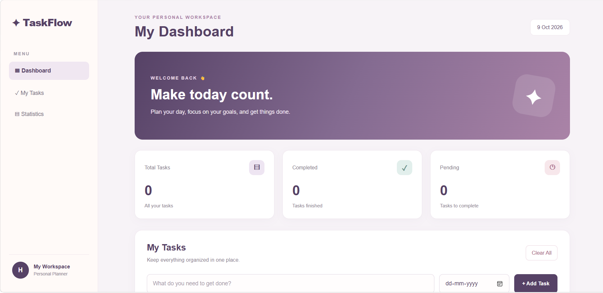

# 🚀 TaskFlow — Full-Stack Todo App

TaskFlow is a responsive task management web application built to help users organize their daily tasks, set priorities, manage due dates, and track their productivity.

## 🌐 Live Demo

**[Click here to use TaskFlow](https://todo-app-q6qa.onrender.com/)**

## 📸 Project Preview



## ✨ Features

- Add new tasks with a title and due date
- Edit and delete existing tasks
- Mark tasks as completed or pending
- Set task priorities: High, Medium, and Low
- Search tasks by title
- Filter tasks by completion status
- Sort tasks by priority and due date
- Track total, completed, pending, and overdue tasks
- View task completion progress
- Toggle between light and dark modes
- Responsive user interface

## 🛠️ Technologies Used

**Frontend**
- HTML5
- CSS3
- JavaScript

**Backend**
- Node.js
- Express.js
- REST API

**Tools & Deployment**
- Git and GitHub
- npm
- Render

## ⚙️ Getting Started

### Prerequisites

Install Node.js and npm on your computer.

### Installation

1. Clone the repository:

   ```bash
   git clone https://github.com/hiral1609/todo-app.git
   ```

2. Navigate to the project folder:

   ```bash
   cd todo-app
   ```

3. Install dependencies:

   ```bash
   npm install
   ```

4. Start the application:

   ```bash
   npm start
   ```

5. Open the application in your browser:

   ```text
   http://127.0.0.1:3010/
   ```

## 📁 Project Structure

```text
todo-app/
├── screenshots/
│   └── todo-app.png
├── index.html
├── style.css
├── script.js
├── server.js
├── db.json
├── package.json
├── package-lock.json
├── .gitignore
└── README.md
```

## 🔌 API Endpoints

| Method | Endpoint | Description |
|---|---|---|
| GET | `/api/tasks` | Retrieve all tasks |
| POST | `/api/tasks` | Create a task |
| PUT | `/api/tasks/:id` | Update a task |
| DELETE | `/api/tasks/:id` | Delete a task |
| GET | `/api/check` | Check backend status |

## 💾 Data Storage

The application currently uses a local JSON file (`db.json`) for task storage during development. For reliable production storage, a persistent database can be integrated.

## 🚀 Future Improvements

- Integrate a persistent database such as PostgreSQL or MongoDB
- Add user authentication and personal task lists
- Add reminders and notifications
- Improve accessibility and testing

## 👩‍💻 Author

**Hiral Shah**

- GitHub: [hiral1609](https://github.com/hiral1609)
- Project Repository: [TaskFlow Todo App](https://github.com/hiral1609/todo-app)
- Live Demo: [TaskFlow](https://todo-app-q6qa.onrender.com/)

---

If you find this project useful, feel free to explore the repository and share your feedback.